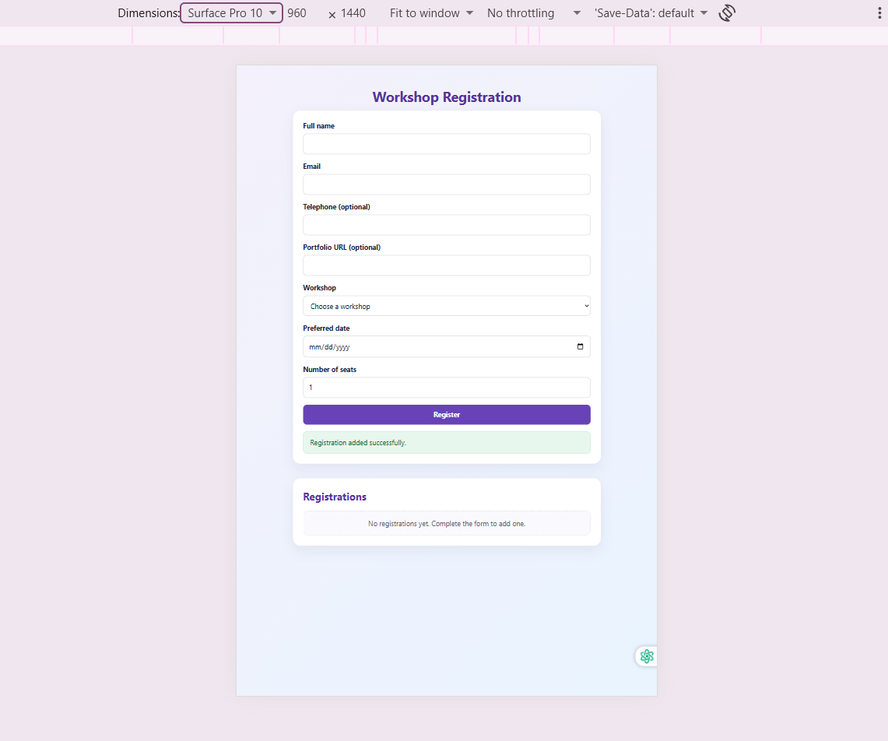
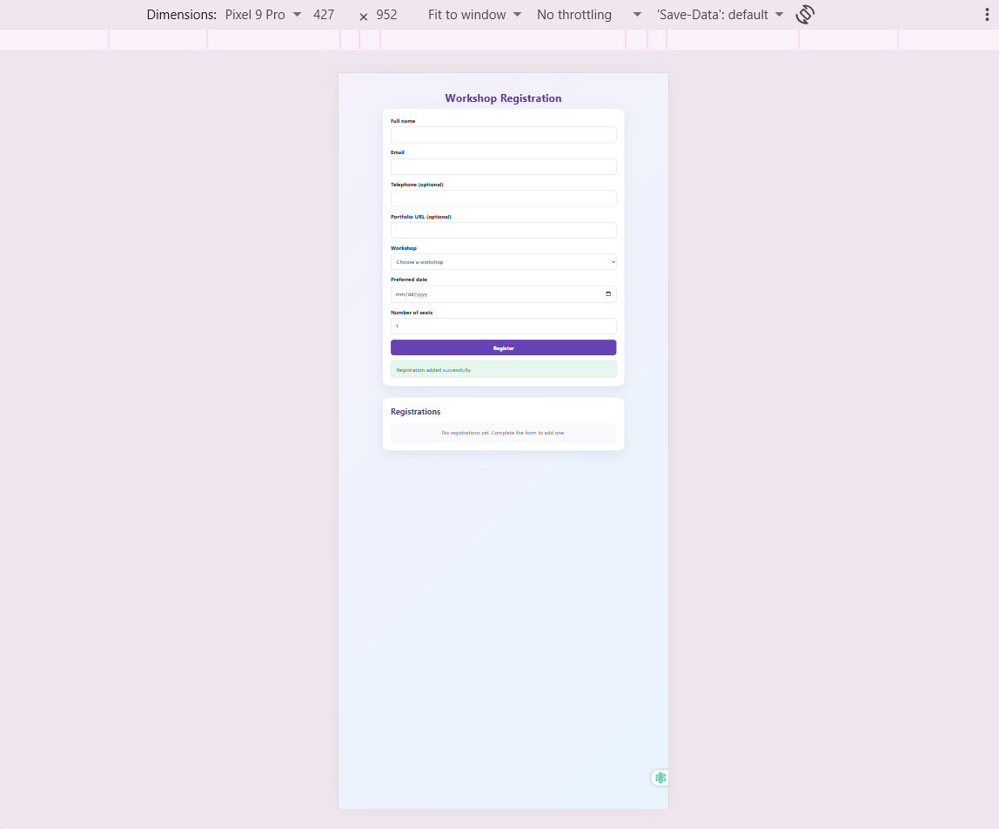

# Interactive Workshop Registration

A responsive React application for registering participants for workshops. It includes controlled form fields, validation, helpful feedback, and a live registration list.

## Features

- Controlled fields for name, email, telephone, portfolio URL, workshop, date, and number of seats
- Clear validation messages beside fields that need correction
- Blocks invalid submissions
- Adds valid registrations to the list immediately
- Removes registrations without mutating the original array
- Responsive layout for desktop and phone screens

## Requirements

- Node.js
- npm

## Run the project

1. Clone this repository or download the project.
2. Open the project folder in a terminal.
3. Install dependencies:

npm install

4. Start the development server:

npm run dev

5. Open the local address displayed in the terminal.

## How to use the app

1. Enter your name and email.
2. Optionally enter your telephone number and portfolio URL.
3. Choose a workshop, preferred date, and number of seats.
4. Select **Register**. Correct any errors shown.
5. Use **Remove** to delete a registration from the list.

## React concepts practised

This assignment practises `useState`, controlled form fields, event handling, validation, conditional rendering, and immutable array updates using the spread operator and `filter()`.

## Screenshots

### Desktop view

### Phone view

## GitHub repository

[Interactive Workshop Registration](https://github.com/RaimaMuhammad/Interactive-Workshop-Registration)

## Conclusion

This project demonstrates a responsive workshop registration app built with React, including form validation and a live registration list.